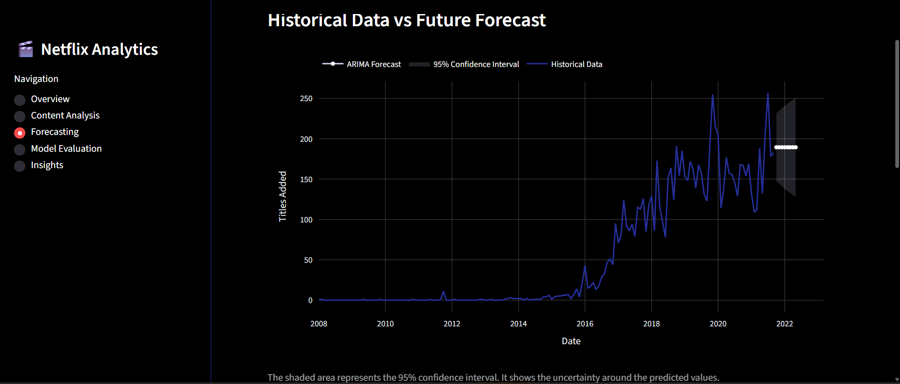
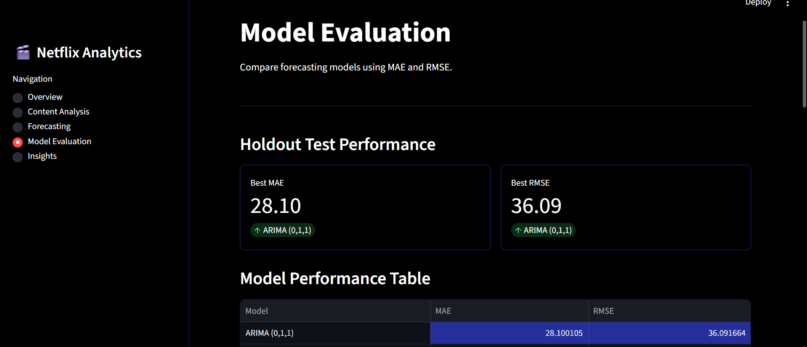
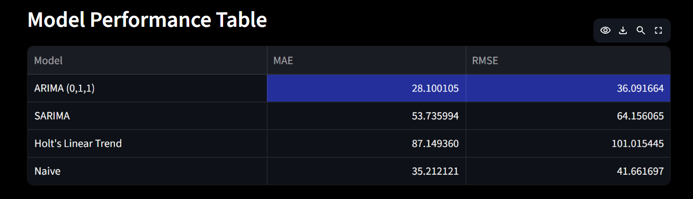
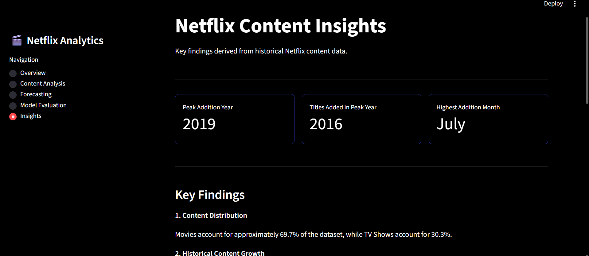

# Netflix Trend Forecasting

A time-series forecasting project that analyzes Netflix's past content additions and predicts how many titles may be added in future months using different forecasting models.

## Live Demo

[Try Netflix Trend Forecasting](https://netflix-trend-forecasting.streamlit.app/)

## About the Project

Netflix Trend Forecasting is a time-series forecasting application developed using Python and Streamlit. It uses historical Netflix data to understand how content additions have changed over time.

I tested different forecasting models to see how well they could predict future monthly content additions.

The application allows users to explore historical trends, generate forecasts, compare model performance and download forecast results.

## Features

- Analysis of Netflix content distribution.
- Yearly and monthly content addition trends.
- Date-based feature preparation and stationarity checking.
- Forecasting using ARIMA, SARIMA and Holt's Linear Trend.
- Comparison with a simple Naive forecasting method.
- Option to change the number of months to forecast.
- Displays 95% confidence intervals.
- Model comparison using MAE and RMSE.
- Downloadable forecast results as a CSV file.
- Interactive dashboard built using Streamlit.

## Forecasting Approach

### 1. Data Preprocessing

- Loaded and explored the Netflix dataset.
- Converted the date column into datetime format.
- Extracted year and month from the date column.
- Prepared monthly content addition data for forecasting.

### 2. Historical Trend Analysis

- Studied yearly and monthly content additions.
- Visualized changes in Netflix content additions over time.
- Checked whether the time-series data was stationary.

### 3. Model Building

Tested different forecasting models:

- ARIMA
- SARIMA
- Holt's Linear Trend
- Naive Forecasting

### 4. Future Forecasting

Used ARIMA to predict future monthly content additions.

The dashboard also allows users to change the number of months for forecasting and view the predicted values with 95% confidence intervals.

### 5. Model Evaluation

Compared the forecasting models using MAE and RMSE. Rolling-origin validation was also used to check how the models performed across different forecasting periods.

## Technologies Used

- Python
- Pandas
- NumPy
- Matplotlib
- Plotly
- Statsmodels
- Scikit-learn
- Streamlit
- Jupyter Notebook

## Model Evaluation

I tested the models using a holdout test dataset and compared their results.

| Model               |   MAE |   RMSE |
| ------------------- | ----: | -----: |
| ARIMA (0,1,1)       | 28.10 |  36.09 |
| SARIMA              | 53.74 |  64.16 |
| Holt's Linear Trend | 87.15 | 101.02 |
| Naive               | 35.21 |  41.66 |

ARIMA (0,1,1) gave the lowest MAE and RMSE in the holdout test.

However, during rolling-origin validation, the Naive model performed slightly better than ARIMA. This means ARIMA did not perform better in every evaluation.

## Dataset

The project uses a Netflix titles dataset containing information such as content type, release year, date added, country and rating.

**Note:** The dataset ends in 2021. Therefore, the forecasts are based on past content addition patterns and do not represent Netflix's actual current or future releases.

## Project Structure

```text
Netflix-Trend-Forecasting/
│
├── app.py
├── Dataset.csv
├── analysis.ipynb
├── requirements.txt
├── README.md
│
└── screenshots/
    ├── overview_page.png
    ├── content_analysis_page.png
    ├── forecasting_page.png
    ├── model_evaluation_page.png
    ├── performance_table.png
    └── insights_page.png
```

## Installation and Execution

### 1. Clone the Repository

```bash
git clone https://github.com/dharshinimr0211-arch/Netflix-Trend-Forecasting.git
```

### 2. Navigate to the Project Folder

```bash
cd Netflix-Trend-Forecasting
```

### 3. Install Dependencies

```bash
pip install -r requirements.txt
```

### 4. Run the Application

```bash
streamlit run app.py
```

The application will open in your browser.

## Application Preview

### 1. Overview


### 2. Content Analysis


### 3. Forecasting



### 4. Model Evaluation





### 5. Insights



## Limitations

- The dataset only contains information up to 2021.
- Sudden changes in content additions are difficult to predict.
- Model performance changes depending on the evaluation method.
- Predictions are based on historical trends and may not match actual future content additions.

## Conclusion

Through this project, I learned how to work with time-series data, analyze historical trends, build forecasting models and compare their performance.

I also understood how different forecasting models perform under different evaluation methods and how historical data can be used to generate future predictions.
