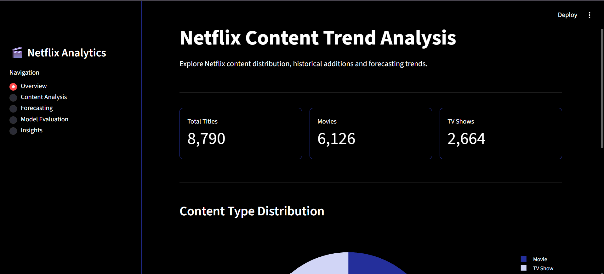
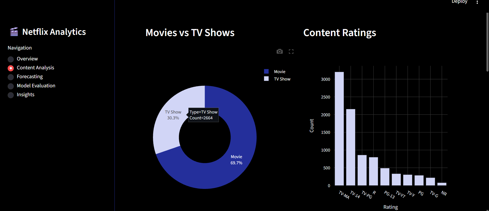
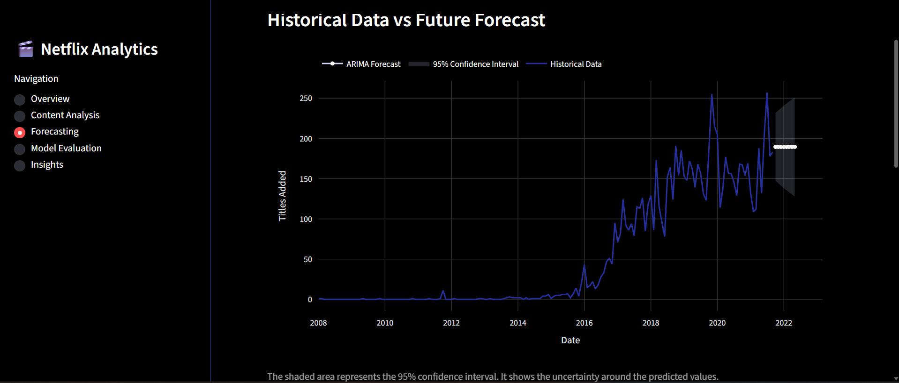
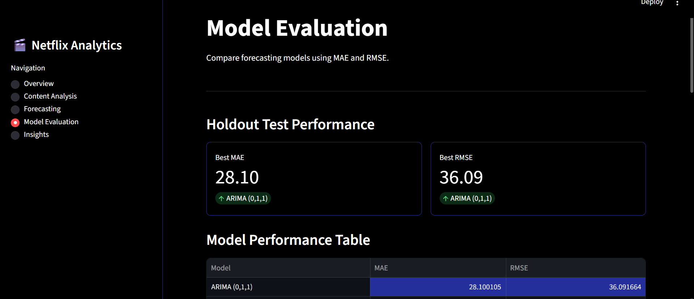
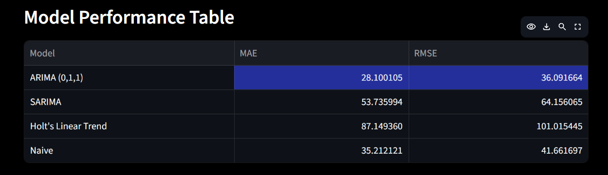
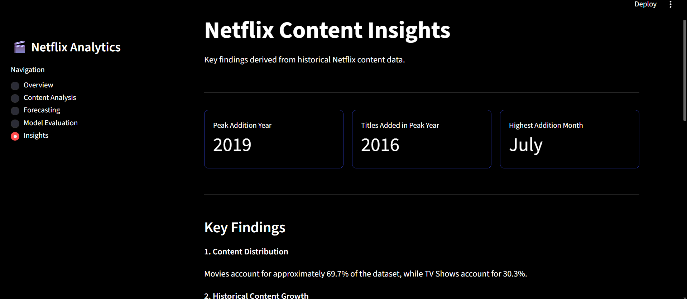

# Netflix Trend Forecasting

A time-series forecasting project that looks at Netflix's past content additions and predicts how many titles may be added in future months using different forecasting models.

The project includes data analysis, model comparison and an interactive dashboard built using Streamlit.

## Project Overview

This project uses historical Netflix data to understand how content additions have changed over time. I tested different forecasting models to see how well they could predict future content additions.

The Streamlit dashboard allows users to explore the trends, generate forecasts and compare model performance.

## Features

- Analysis of Netflix content distribution.
- Yearly and monthly content addition trends.
- Preparing date-based features and checking stationarity.
- Forecasting using ARIMA, SARIMA and Holt's Linear Trend.
- Comparing the models with a simple Naive forecasting method.
- Changing the number of months to forecast.
- Showing 95% confidence intervals.
- Comparing models using MAE and RMSE.
- Downloading forecast results as a CSV file.

## Technologies Used

- Python
- Pandas
- NumPy
- Matplotlib
- Plotly
- Statsmodels
- Scikit-learn
- Streamlit
- Jupyter Notebook

## Project Workflow

1. **Time-Based Feature Preparation:** Converted the date column into datetime format and extracted the year and month.
2. **Historical Trend Analysis:** Studied yearly and monthly content additions and checked whether the data was stationary.
3. **Model Building:** Built and tested ARIMA, SARIMA, Holt's Linear Trend and Naive models.
4. **Future Forecasting:** Used ARIMA to predict future monthly content additions.
5. **Model Evaluation:** Compared the models using MAE, RMSE and rolling-origin validation.

## Model Evaluation

I tested the models using a holdout test dataset and compared their results.

| Model               |   MAE |   RMSE |
| ------------------- | ----: | -----: |
| ARIMA (0,1,1)       | 28.10 |  36.09 |
| SARIMA              | 53.74 |  64.16 |
| Holt's Linear Trend | 87.15 | 101.02 |
| Naive               | 35.21 |  41.66 |

ARIMA (0,1,1) gave the lowest MAE and RMSE in the holdout test.

However, during rolling-origin validation, the Naive model performed slightly better than ARIMA. This means ARIMA did not perform better in every evaluation.

## Dashboard Screenshots

### 1. Overview



### 2. Content Analysis



### 3. Forecasting



### 4. Model Evaluation





### 5. Insights



## Project Structure

```text
Netflix-Trend-Forecasting/
│
├── app.py
├── Dataset.csv
├── analysis.ipynb
├── requirements.txt
├── README.md
│
└── screenshots/
    ├── overview_page.png
    ├── content_analysis_page.png
    ├── forecasting_page.png
    ├── model_evaluation_page.png
    ├── performance_table.png
    └── insights_page.png
```

## How to Run the Project

**1. Clone the repository**

```bash
git https://github.com/dharshinimr0211-arch/Netflix-Trend-Forecasting.git
```

**2. Open the project folder**

```bash
cd Netflix-Trend-Forecasting
```

**3. Install the required libraries**

```bash
pip install -r requirements.txt
```

**4. Run the Streamlit application**

```bash
streamlit run app.py
```

The application will open in your browser.

## Dataset

The project uses a Netflix titles dataset with details such as content type, release year, date added, country and rating.

**Note:** The dataset ends in 2021. So, the forecasts are based on past content addition patterns and do not represent Netflix's actual current or future releases.

## Limitations

- The dataset only contains information up to 2021.
- Sudden changes in content additions are difficult to predict.
- Model performance changes depending on the evaluation method.
- The predictions are based on historical trends and may not match actual future content additions.

## Conclusion

Through this project, I learned how to work with time-series data, analyze historical trends, build forecasting models and compare their performance.
