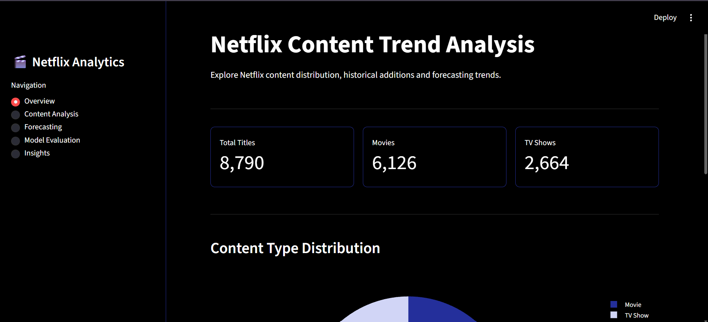
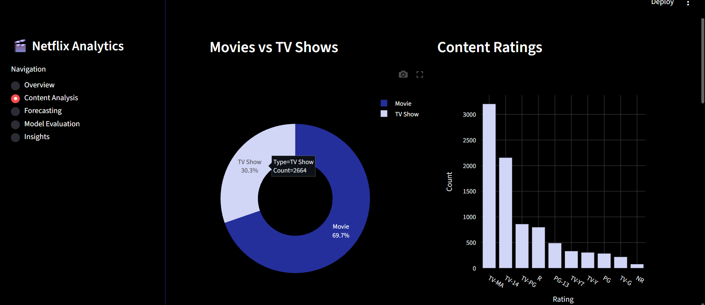

# Netflix Content Type Prediction

A machine learning classification model that predicts whether a Netflix title is a Movie or TV Show based on its release year and country.

## Live Demo

[View Live Application](YOUR_STREAMLIT_APP_URL)

## About the Project

Netflix Content Type Prediction is a machine learning application developed using Python and Streamlit. It uses information such as release year and country to classify Netflix titles into Movies or TV Shows.

The project involves data preprocessing, training different classification models and comparing their performance to select a suitable model.

The application allows users to explore Netflix content, view model performance and predict the content type by entering a release year and country.

## Features

- Analysis of Netflix Movies and TV Shows.
- Visualization of content type distribution.
- Analysis of ratings, countries and popular genres.
- Training and comparison of Logistic Regression, Decision Tree and Random Forest models.
- Hyperparameter tuning using GridSearchCV.
- Evaluation using accuracy, precision, recall and F1-score.
- Predicts whether a title is a Movie or TV Show.
- Interactive dashboard built using Streamlit.

## Machine Learning Approach

### 1. Data Preprocessing

- Loaded and explored the Netflix dataset.
- Checked for missing values and duplicate records.
- Selected relevant features for classification.
- Used release year and country as input features.
- Excluded duration because it directly indicates the content type.

### 2. Model Training

Trained and compared three classification algorithms:

- Logistic Regression
- Decision Tree Classifier
- Random Forest Classifier

### 3. Hyperparameter Tuning

Used GridSearchCV to find suitable parameters for the Decision Tree classifier.

### 4. Model Evaluation

Evaluated the models using accuracy, precision, recall and F1-score.

The tuned Decision Tree was selected as the final model because it provided better recall for the TV Show class.

It achieved 71.16% accuracy, with a macro F1-score of 0.69 and TV Show recall of 74%.

## Technologies Used

- Python
- Pandas
- NumPy
- Scikit-learn
- Matplotlib
- Seaborn
- Plotly
- Joblib
- Streamlit
- Jupyter Notebook

## Dataset

The project uses a Netflix Movies and TV Shows dataset containing information about titles, genres, directors, countries, ratings, release years and content types.

The dataset contains 8,790 records and 10 columns.

## Project Structure

```text
Netflix-Content-Type-Prediction/
│
├── app.py
├── content.ipynb
├── dataset.csv
├── requirements.txt
├── README.md
│
├── models/
│   └── netflix_content_type_model.pkl
│
└── screenshots/
    ├── overview_page.png
    ├── content_analysis_page.png
    ├── model_performance_page.png
    └── prediction_page.png
```

## Installation and Execution

### 1. Clone the Repository

```bash
git clone YOUR_GITHUB_REPOSITORY_URL
```

### 2. Navigate to the Project Folder

```bash
cd Netflix-Content-Type-Prediction
```

### 3. Create a Virtual Environment

```bash
python -m venv venv
```

### 4. Activate the Virtual Environment

For Windows:

```powershell
venv\Scripts\activate
```

### 5. Install Dependencies

```bash
pip install -r requirements.txt
```

### 6. Run the Application

```bash
streamlit run app.py
```

The application will open in your browser.

## Application Preview

### Overview



### Content Analysis



### Model Performance


### Content Type Prediction


